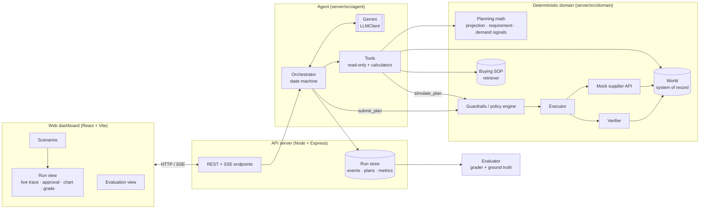
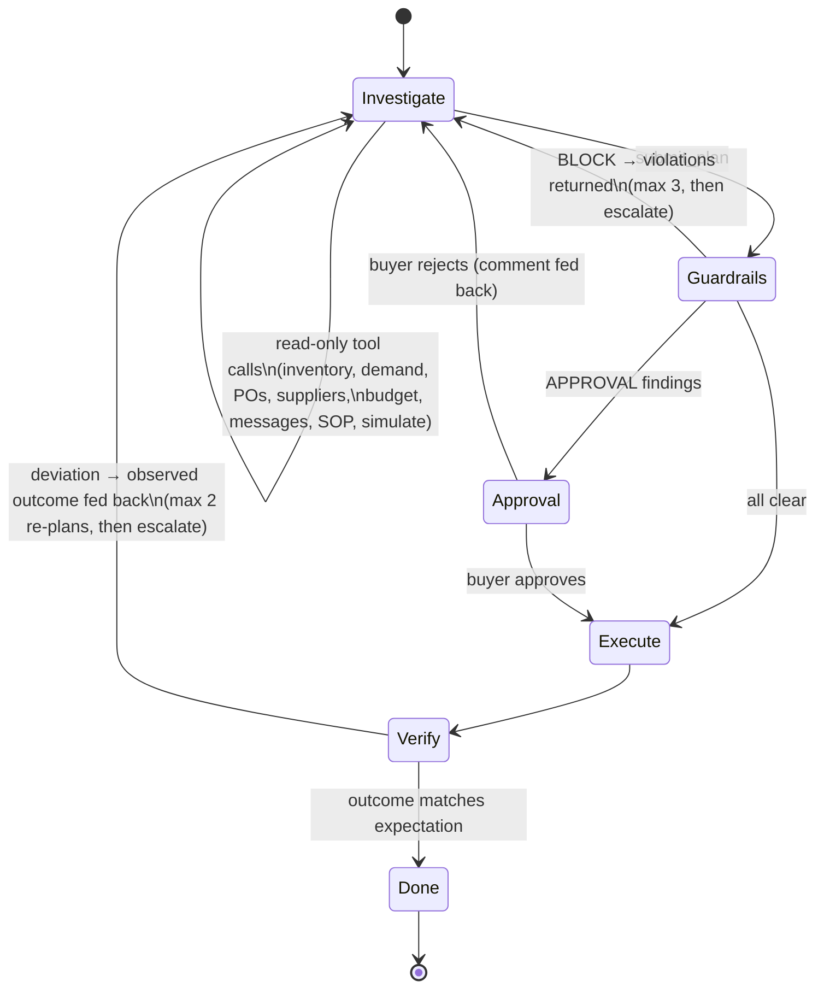

# Architecture

## System overview

## The agent loop

The LLM only **proposes**. Everything that changes state or judges an outcome is deterministic code.

| Stage | Who | What happens |
|---|---|---|
| Investigate | LLM + tools | ReAct loop over 13 read-only tools. Numbers come from calculators (`calculate_requirement`, `simulate_plan`), never from the model's head. |
| Decide | LLM | One structured `Plan` via `submit_plan`: decision, key factors with evidence, demand assumption, actions, **expected outcome**. |
| Guardrails | `domain/policy.ts` | Budget, MOQ/case size, supplier capacity, lead time, storage peak, shelf life, overstock, plan self-consistency. Each finding is `BLOCK`, `APPROVAL` or `INFO`. |
| Approval gate | Human (or eval auto-approver) | Only for high-impact actions: PO value > ₹1.5L, cancellations, low-reliability suppliers, upsizing > 25% over recommendation, overstock. |
| Execute | `domain/execution.ts` + `supplierApi.ts` | Writes POs to the system of record; the mock supplier may confirm partially, reject, slip or re-price. |
| Verify | `domain/execution.ts` | Independent read-back of every PO, budget and storage re-check, and a fresh projection compared to the agent's own `expectedOutcome`. |
| Re-plan | LLM | Receives the observed outcome inside the `submit_plan` response and submits a follow-up plan with only the additional actions — or escalates. |

## Data model (mock system of record)

`server/src/domain/types.ts`

- **Product** — category (budget bucket), unit cost, storage zone, shelf life, criticality
- **FulfillmentNode** — dark store with zone capacities (ambient / chilled / frozen) shared with other products
- **Inventory** — on hand per SKU × node
- **Demand** — 28 days of sales history, what the forecast said for those days, forward daily forecast, ops notes
- **Promotion** — promo calendar (explains spikes)
- **Supplier** — fill rate, on-time rate, incident history (supplier "memory")
- **SupplierOffer** — price, MOQ, case size, lead time, catalogue-advertised availability
- **PurchaseOrder** — status lifecycle `SUBMITTED → CONFIRMED | PARTIALLY_CONFIRMED | SUPPLIER_EXCEPTION | REJECTED_BY_SUPPLIER | CANCELLED`
- **Budget** — category limit and committed spend (kept in sync with confirmed PO value)
- **Recommendation** — output of the (fallible) replenishment engine
- **SupplierMessage** — free-text emails/portal messages the agent must interpret
- **Escalation** — buyer inbox items raised by the agent or the system
- **SupplierBehavior** — hidden "real" behaviour of the supplier used by the mock supplier API (the agent never sees it)

Time is integer days relative to today (day 0), which keeps the planning math and fixtures reproducible.

## Why this shape

- **Separation of proposing and disposing.** The model is good at reading messy evidence (a supplier email, a promo that explains a spike, a stale snapshot) and weighing trade-offs; it is bad at arithmetic and should never hold write access. So it gets calculators and a single, validated write path.
- **Same functions everywhere.** Tools, guardrails, verifier and grader all use `planning.ts`, so the agent, the safety layer and the evaluator can't disagree about what "stockout on day 8" means.
- **Expected outcome as a contract.** Each plan states what should be true after execution (`noStockoutThroughDay`). That turns verification into a concrete comparison instead of a vague "looks fine", and it is also checked *before* execution (a plan whose own simulation contradicts its expectation is blocked as `PLAN_INCONSISTENT`).
- **Bounded autonomy.** Every loop has a budget (LLM steps, guardrail rejections, re-plans). When a budget runs out the system escalates to a human instead of looping or guessing.
- **Provider-agnostic.** The orchestrator depends on a small `LLMClient` interface. Gemini is one implementation; a `ScriptedClient` drives unit tests and the naive baseline through the exact same pipeline.

## Production path (not built, deliberately)

| Here | In production |
|---|---|
| In-memory `World` per run | Postgres (PO, inventory, budget tables) behind the same repository methods; runs/events in Postgres or a trace store |
| Keyword retriever over one SOP file | Embeddings in pgvector over SOPs, supplier contracts, past decisions and outcomes |
| Mock supplier API returns synchronously | Async confirmations via email/EDI/portal webhooks; verification re-runs when a confirmation arrives |
| Single node, single SKU per task | Batch mode: the same agent run over all exceptions each morning, with a queue and per-SKU locks |
| Buyer approval in the dashboard | Approval in Slack/email with the same plan card; SLA-based auto-escalation |
